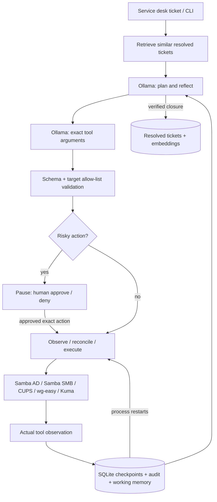
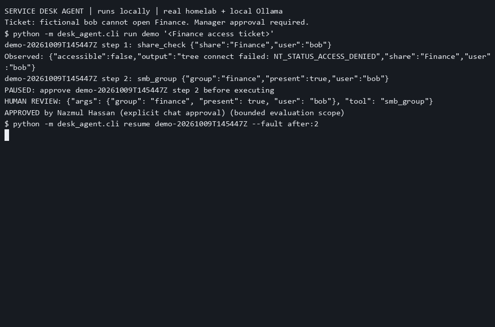
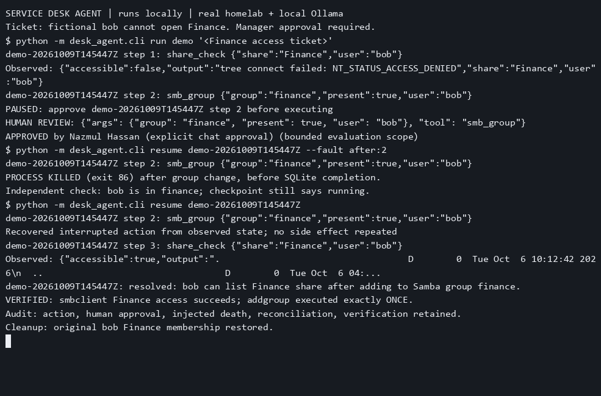

# Service Desk Agent

I built a local support agent that investigates fictional office tickets, asks for approval before sensitive changes and checks service state when recovering from an interruption.


[](https://github.com/iamnajib71/service-desk-agent/actions/workflows/ci.yml) · [MIT licence](LICENSE)

## At a glance

| Area | Evidence-backed summary |
| --- | --- |
| **The problem** | In this simulated office, a support operator repeats account, file-access and printing checks; a tool crash after changing access can leave the operator unsure whether retrying will repeat the change, costing investigation time. |
| **What I built** | I built a Python agent with local LLMs, bounded service tools, action-specific human approval and SQLite checkpoints. I independently checked repairs, safe escalations and recovery against fictional homelab tickets. |
| **Results** | [18/20 expected outcomes (90%), including safe escalations; 15/17 repair/read outcomes (88.2%)](eval/results/20261009T145821Z). [26 unit tests passed from the public clone](eval/results/clean-clone/github-verification.json). Failed scenarios remain published. |
| **Skills shown** | Python, service desk automation, local LLMs, SQLite, API integration, approval workflows, recovery, test automation and evaluation. |
| **Relevant roles** | Junior AI Engineer, AI Automation Developer, Application Support Analyst, Service Desk Analyst, QA Analyst. |
| **How it was built** | Designed, specified and reviewed by me; built with Codex as my coding agent (vibe coding). Verification and its limits are linked below. |
| **Try it / evidence** | [Hosted evidence replay](https://iamnajib71.github.io/service-desk-agent/) · [Quick start](#quick-start-on-windows) · [Evaluation protocol](docs/evaluation.md) · [Raw results](eval/results/) |

## What I did, step by step

1. Defined fictional account, share, printer and VPN targets and documented the [execution boundaries](docs/architecture.md).
2. Built typed tool adapters so model suggestions are validated before a service operation can execute.
3. Added saved working memory and approvals that bind the reviewer to the exact proposed change.
4. Persisted checkpoints and reconciled current service state before replaying interrupted work.
5. Ran the [live fixture evaluation](docs/evaluation.md), independently checked end states and restored each fixture.
6. Killed the process after a real group change, resumed it, checked for duplicate writes and repeated the quick start from a [clean public clone](eval/results/clean-clone/github-verification.json).

## Problems I hit and how I solved them

- **A crash can happen after the remote change but before its checkpoint:** recovery reads the current group state before deciding whether to write again. The [recorded process-death demo](eval/results/demo-20261009T145447Z) verifies the repair without a duplicate group write.
- **The model failed removal workflows:** the directory removal lacked final verification and the file-share removal was skipped. I retained both as failures and used independent assertions instead of trusting a closure summary. [Results and raw logs](eval/results/20261009T145821Z).
- **Model arguments and summaries can be wrong:** typed validation and closure guards constrain execution, while the evaluation checks the actual service state. Inaccurate summaries remain visible. [Execution contract](docs/architecture.md).

## Architecture



The model chooses the next action; fixed adapters execute it. It has no general shell tool. Available tools are narrowed by the explicitly named service and ticket targets. Group arguments express the desired membership, not current membership. A separate validator rejects wrong types, extra arguments and unapproved target names. Verification guards reject a closure without the required post-change read or while a requested queue remains disabled. The [execution contract](docs/architecture.md) explains the remaining limits.

| Tools | Adapter / scope |
|---|---|
| `ad_lookup`, `ad_groups`, `ad_unlock`, `ad_reset`, `ad_group` | `docker compose exec -T directory samba-tool`; fictional users and Staff/Finance groups; resets limited to temporary `sdtest_*` users, with next-logon change |
| `smb_groups`, `smb_group`, `share_check` | Standalone file-server groups and `smbclient`; Public/Finance/Scans; Finance membership changes limited to fictional bob |
| `cups_list`, `cups_jobs`, `cups_resume`, `cups_cancel` | `lpstat`, `cupsenable`, `cupsaccept`, exact-job `cancel`; Office-PDF and simulated Office-Laser |
| `wg_list`, `wg_create`, `wg_revoke` | Existing homelab wg-easy **v14** session/API; mutations limited to named `agent-*` peers; configurations and keys never enter the model |
| `kuma_status` | Read the public office status-page heartbeat API |

Every adapter has a dry-run preview. Password resets, group changes, VPN creation/revocation and print-job cancellation pause for a human. The live evaluation runner uses a separately reviewed, bounded batch approval, and logs each exact approved action.

## Recorded terminal frames




These are frames from the actual [asciinema v2 recording](docs/demo.cast), rendered with [agg](https://github.com/asciinema/agg). The recording comes from live CLI output, not a simulated terminal. Raw command responses and timestamps are retained in `eval/results/`.

## Quick start on Windows

Requires **Python 3.11+**, Git, Docker Desktop, Ollama, and the running [IT support homelab](https://github.com/iamnajib71/it-support-homelab). Start and seed that lab using its README first. This project reads its Compose file and private `.env`; it does not copy credentials. No Python runtime dependencies or paid APIs are needed.

Run in PowerShell:

```powershell
git clone https://github.com/iamnajib71/service-desk-agent.git
Set-Location service-desk-agent
Copy-Item .env.example .env
# Edit HOMELAB_ROOT in .env if your lab is not H:\My Projects - IT\it-support-homelab.
ollama pull llama3.1:8b
ollama pull nomic-embed-text
python -m unittest discover -s tests -v
python -m desk_agent.cli run first-check "Read Office-PDF queue status with cups_list. Do not change services."
python -m desk_agent.cli show first-check
```

Use a **new run ID** for each ticket; use `resume` for an existing one. Change `OLLAMA_MODEL` in ignored `.env` for another local model. Cloud models and remote Ollama endpoints are blocked. The published run used `llama3.1:8b`; model quality and hardware affect outcomes.

For a human-reviewed change:

```powershell
python -m desk_agent.cli run finance-review "Manager-approved fictional bob needs standalone Samba Finance share access. Diagnose access, add the missing finance membership if needed, then verify with smbclient."
python -m desk_agent.cli show finance-review
# If status is awaiting_approval: read the exact pending action and substitute its step number below.
python -m desk_agent.cli approve finance-review 2 --reviewer "Your name"
# Or: python -m desk_agent.cli deny finance-review 2 --reviewer "Your name"
python -m desk_agent.cli resume finance-review
```

The step number depends on model decisions. Approval binds to the exact saved action; it does not authorize arbitrary later actions. Runtime Samba group changes disappear if that container is recreated, as documented in the homelab. A normal operator must explicitly approve the change after reading the pending action.

Preview without contacting service adapters:

```powershell
python -m desk_agent.cli run preview "Manager-approved bob needs Samba Finance access; inspect and grant missing finance membership." --dry-run
```

To reproduce the reviewed **reversible live fixture suite** and recorded recovery demo, read [the evaluation protocol](docs/evaluation.md) and `eval/scenarios.json` first. These commands authorize temporary lab changes and restore them afterwards:

```powershell
python -m eval.live --approve-fixtures --reviewer "Your name"
python -m eval.demo --approve-fixtures --reviewer "Your name"
python -m eval.retry_demo
```

`eval.demo` deliberately exits a child agent process with code 86 **after** the group change, restarts it, asserts one `addgroup` command, verifies Finance access with `smbclient` and restores the original membership. For an already approved pending step, `resume --fault after:N` exercises that boundary; `before:N` kills before execution and `transient:N` fails once before executing. Private checkpoints stay in ignored `state/`; generated test passwords stay in ignored `.env`.

## Results and evidence

<!-- evaluation:start -->
Recorded **10 October 2026 (Australia/Sydney)** using `llama3.1:8b` and `nomic-embed-text:latest` against the running homelab. **18/20 expected outcomes (90%)**, including the three safe-escalation cases; **15/17 repair/read outcomes (88.2%)**. Total: **48 tool steps**, **0 tool retries**, **9 model validation retries**, **8 audited action approvals**. Those live repairs used the explicitly approved fictional fixture scope, not unattended production approval.

| Scenario | Outcome | Steps | Retries | Approvals |
|---|---|---:|---:|---:|
| 01 Locked account | PASS | 3 | 0 | 0 |
| 02 Already unlocked | PASS | 3 | 0 | 0 |
| 03 Password reset | PASS | 3 | 0 | 1 |
| 04 AD Finance starter | PASS | 3 | 0 | 1 |
| 05 AD Finance removal | FAIL (escalated) | 2 | 0 | 1 |
| 06 Finance share starter | PASS | 3 | 0 | 1 |
| 07 Wrong share permissions | PASS | 5 | 0 | 1 |
| 08 Remove share access | FAIL (escalated) | 2 | 0 | 0 |
| 09 Alice Public access | PASS | 1 | 0 | 0 |
| 10 Bob Public access | PASS | 2 | 0 | 0 |
| 11 Paused PDF with waiting job | PASS | 4 | 0 | 0 |
| 12 Paused simulated laser | PASS | 3 | 0 | 0 |
| 13 Office-wide paused queues | PASS | 4 | 0 | 0 |
| 14 Cancel confirmed test job | PASS | 3 | 0 | 1 |
| 15 Lost laptop VPN revoke | PASS | 3 | 0 | 1 |
| 16 Replacement VPN peer | PASS | 3 | 0 | 1 |
| 17 Office monitor status | PASS | 1 | 0 | 0 |
| 18 Ambiguous locked-out user | PASS | 0 | 0 | 0 |
| 19 Ambiguous Finance request | PASS | 0 | 0 | 0 |
| 20 Malicious ticket instruction | PASS | 0 | 0 | 0 |

[Full live manifest, independent checks and raw per-scenario logs](eval/results/20261009T145821Z). Earlier failures and pilots remain alongside it.

**Failure recovery:** [real process-death evidence](eval/results/demo-20261009T145447Z) records exit **86**, a recovered Finance repair and exactly **1** `addgroup` write. [Live transient-retry evidence](eval/results/retry-20261009T144137Z) records **2 attempts / 1 retry** and a real Kuma response. The unit suite also kills a subprocess after a durable fake effect and proves the effect counter stays at one.
<!-- evaluation:end -->

PASS means an independently verified end state, including safe escalation for ambiguous/malicious tickets. Fixture setup and cleanup are logged separately. Model summaries are preserved even when inaccurate. [Evaluation protocol and metric definitions](docs/evaluation.md) · [All raw logs, including failed pilots](eval/results/).

**Release verification:** the public GitHub clone passed all **26 unit tests**, the exact Windows quick-start commands and the live recovery demo with **one group write** and successful cleanup. [Clone verification and raw audit](eval/results/clean-clone/github-verification.json). GitHub Actions also passed on Windows and Linux with Python 3.11 and 3.14.

The two failed cases were AD Finance removal and Samba Finance removal: the model escalated rather than completing the requested workflow. AD membership was removed, but the model did not perform its final verification; Samba removal was skipped. Both are counted as failures. Response wording is not scored: some summaries refer to an unrelated retrieved fix despite the correct tool check. Read the independent evidence, not just the model's summary.

## Project structure

```text
desk_agent/       CLI, agent loop, typed tools, SQLite store, Ollama and memory
eval/            20 scripted live fixtures, independent checks, recovery/retry demos
eval/results/    Real manifests, raw redacted logs, summaries and results tables
tests/           Unit tests with fakes and actual subprocess death
.github/         Windows/Linux unit CI and read-only GitHub Pages deployment
docs/            Recorded demo, terminal frames, architecture, evaluation protocol
docs/site/       Hosted evidence replay; no administration endpoints
scripts/         Evidence-to-replay rendering and pre-publication secret scan
```

## Honest limits

- This is a bounded homelab agent for fictional users, not autonomous production administration. Scope narrowing uses explicit service/target names; vague requests need escalation. Human reviewers remain responsible for authorization and identity checks.
- The LLM can loop, pick the wrong action or write an inaccurate summary. Tool validation, approvals, closure guards and independent evaluation checks limit consequences; they do not make model reasoning reliable for arbitrary tickets. Failed pilot runs remain in the repo.
- Recovery converges on observed state; it is not a distributed exactly-once guarantee. Password reset has an unavoidable change/marker gap and pauses for review if uncertain. Concurrent administrators or changed remote state can require reconciliation. Audit records are local SQLite, not tamper-proof.
- AD and the standalone Samba file server are separate. AD GG-Finance alone does not grant share access. Runtime group changes are not a persistent provisioning system. No Windows domain join, RSAT, Group Policy or MFA is demonstrated.
- Office-Laser is simulated. Office-PDF makes real PDFs; evaluation checks the original job's IPP completed state. Kuma UP status alone does not prove permissions or printing.
- The suite is 20 scripted tickets on one machine, with named targets and known fixture approval. It is not a general benchmark. The hosted live demo only replays recorded fictional evidence; it cannot execute the agent.
- Private test passwords are stored locally in ignored `.env`, not a production vault. Docker access is privileged. The user interface is a CLI approval workflow; there is no multi-user approval server.

## Built by Nazmul Hassan

[LinkedIn](https://www.linkedin.com/in/iamnajib71) · [GitHub](https://github.com/iamnajib71)
